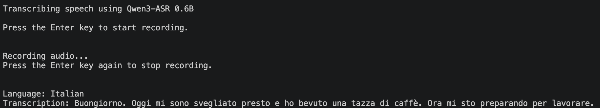

# Local ASR with Qwen3

A local speech-to-text application using **Qwen3-ASR 0.6B** and **Ollama**.

The application records speech through your microphone, transcribes it locally, and supports system-wide voice typing across browsers, text editors, and other applications. Currently developed and tested on macOS.

## Features

- Offline speech-to-text using Qwen3-ASR 0.6B
- Supports multiple languages
- Automatic language detection
- System-wide voice typing using a global keyboard shortcut
- Automatic text insertion into the active application
- No API key required

## Project Structure
```text
local-asr-qwen3/
├── src/
│   ├── __init__.py
│   ├── main.py
│   ├── audio.py
│   ├── transcriber.py
│   ├── dictation.py
│   ├── voice_commands.py
│   ├── text_inserter.py
│   └── system_wide.py
├── tests/
│   ├── test_transcriber.py
│   └── test_voice_commands.py
├── .env
├── .gitignore
├── pyproject.toml
├── image-1.png
└── README.md
```

## Setup

### 1. Install Ollama

Download and install [Ollama](https://ollama.com).

### 2. Download the model

```bash
ollama pull frozenlab/qwen3-asr:0.6b
```

### 3. Clone the repository

```bash
git clone https://github.com/soundarya-dg/local-asr-qwen3.git
cd local-asr-qwen3
```

### 4. Create a virtual environment

```bash
python3 -m venv .venv
source .venv/bin/activate
```

### 5. Install dependencies

```bash
pip install -e ".[dev]"
```

### 6. Configure environment variables

Create a `.env` file in the project root with:

```env
OLLAMA_URL=http://127.0.0.1:11434/api/chat
MODEL_NAME=frozenlab/qwen3-asr:0.6b
```

## Usage

### Terminal-based transcription (Phase 1)

```bash
python -m src.main
```
Press Enter to start recording and press Enter again to stop. The transcription and detected language will be displayed in the terminal.

**Output:**


### System-wide voice typing (Phase 2)

```bash
python -m src.system_wide
```

- Click inside a text field in any supported application.
- Press **Control + Option + Space** to start recording and press the same shortcut again to stop.
- The recognized text will automatically be inserted into the active text field.
- Keep the Python process running while using system-wide voice typing.


## Notes
- Currently developed and tested on macOS.
- System-wide voice typing requires the Python process to remain running.
- Recording is limited to 5 minutes, and system-wide dictation processes audio in short chunks.
- Spoken stop commands are experimental and depend on transcription accuracy.
- Microphone, Input Monitoring, and Accessibility permissions are required for system-wide voice typing. Make sure they are enabled in your system settings.
- Audio is processed locally and is not permanently saved.
- The application currently does not provide a graphical interface.
- Qwen3-ASR supports 30 languages, including English, German, Spanish, French, and Italian. For the full list of supported languages, check the official [Qwen3-ASR repository](https://github.com/QwenLM/Qwen3-ASR).
